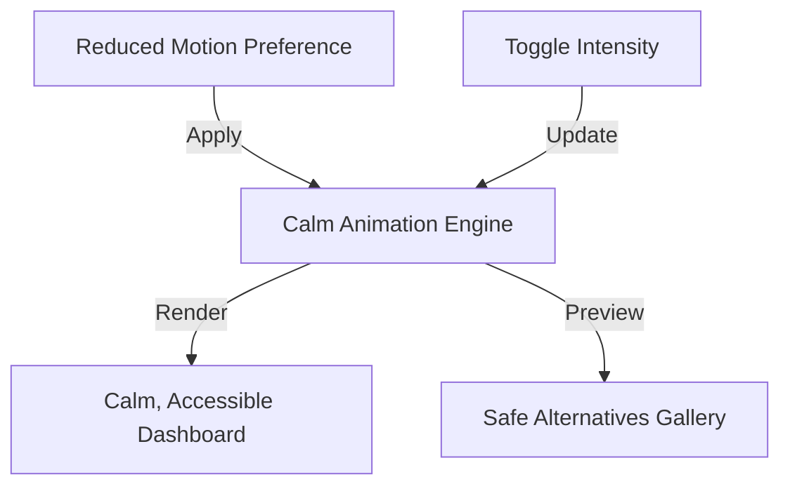

# wax-reduced-motion-dashboard — Reduced-Motion Dashboard with Calm Alternatives

> **Status:** 🔒 Private (In Development) | Target Public Release: August 2026  
> **Category:** Accessibility & Inclusive Design  
> **Parent Catalog:** [pixel-journey/wax-ecosystem-blueprint-catalog](https://github.com/pixel-journey/wax-ecosystem-blueprint-catalog)

**One-sentence goal:** A dashboard that fully respects reduced-motion preferences and provides calm, low-stimulation alternatives for all interactive elements while maintaining full functionality, beautiful design, and delightful (but safe) UX on WAX.

---

## 1. Overview & Goal

This blueprint makes dashboards accessible and calm by default. It eliminates overwhelming motion while keeping everything beautiful and functional.

- **Why it matters for WAX:** Many users prefer or need reduced motion. A calm dashboard improves focus, reduces fatigue, and demonstrates inclusive design.
- **Public infrastructure only:** Client-side preference detection, animation fallbacks, calm design system. No custom contracts.
- **Target users:** Users with motion sensitivity, focus needs, or preference for calm interfaces, accessibility-conscious projects.
- **Success metrics:** "All motion respects user preference with beautiful calm alternatives", "Full functionality preserved", "Delightful calm aesthetic that feels premium".

---

## 2. Concepts & Inspiration

- **Core concepts:** Detect prefers-reduced-motion. Replace all animations with calm alternatives (instant changes, gentle fades, static states). Provide explicit toggle. Maintain visual hierarchy and delight through design, not motion.
- **Pain points:** Dashboards with constant motion can be overwhelming or inaccessible. Users want calm without losing beauty or function.
- **Inspirations:** Calm design systems, reduced-motion accessibility guidelines, modern minimalist dashboards. Web3: calm-by-default with beautiful alternatives.
- **Cross-references:** Perfect with other accessibility blueprints (seizure-safe animations, cognitive-load simplified tx, haptic feedback, screen-reader inventory). Complements all dashboard and analytics tools.

---

## 3. Design Specifications (Pixel Journey Standards)

### 3.1 Visual & Interaction Design
- Clean, calm aesthetic with minimal motion as default.
- Main view: Dashboard with gentle or instant transitions, clear visual hierarchy.
- Controls: Global reduced-motion toggle, per-component intensity, calm mode preview.
- Micro-interactions: Subtle, safe transitions that feel premium without stimulation.
- Responsive: Excellent on desktop and mobile.

### 3.2 Key Views / Components
- `ReducedMotionDashboard.tsx` — Main calm dashboard component.
- `CalmTransition.tsx` — Elegant, low-motion transition wrapper.
- `MotionToggle.tsx` — Clear global and per-section toggles.
- `CalmAlternatives.tsx` — Gallery of safe replacements for common animations.
- `FocusMode.tsx` — Optional ultra-calm focus mode.

### 3.3 Accessibility (A11y) & Inclusive Design
- WCAG 2.2 AA: Full keyboard support, screen reader support, high contrast.
- Strong respect for prefers-reduced-motion.
- Clear explanations and easy toggles.

### 3.4 Performance & Optimization Targets
- Lightweight calm animation system.
- Instant mode switching.
- No performance cost for calm alternatives.

---

## 4. Technical Architecture

### 4.1 Core Tech Stack
- Next.js 15 + TypeScript + Tailwind + shadcn/ui + framer-motion (with safe configs)
- prefers-reduced-motion detection
- Calm design token system
- User preference persistence

### 4.2 Data Flow Diagram


### 4.3 Folder Structure
```
app/
├── components/
│   ├── dashboard/
│   │   ├── ReducedMotionDashboard.tsx
│   │   └── CalmTransition.tsx
│   └── controls/
│       └── MotionToggle.tsx
├── hooks/useReducedMotion.ts
├── lib/
│   ├── animation/
│   │   └── calm-engine.ts
│   └── accessibility/
│       └── preference-manager.ts
└── types/accessibility.ts
```

### 4.4 Security & Privacy
- Purely client-side. User preferences stored locally.

---

## 5. Implementation Examples & Code Snippets

**Core reduced motion hook**
```ts
// hooks/useReducedMotion.ts
export function useReducedMotion() {
  const prefersReduced = useMediaQuery('(prefers-reduced-motion: reduce)');
  const [intensity, setIntensity] = useState(prefersReduced ? 0 : 1);

  const getTransition = (config: any) => {
    if (intensity === 0) return { duration: 0 };
    return { ...config, duration: config.duration * intensity };
  };

  return { getTransition, intensity, setIntensity };
}
```

**Calm transition example**
```ts
const calmFade = { opacity: [0, 1], transition: { duration: 0.2 } };
```

---

## 6. Demo & Testing
- Demo mode with motion intensity slider and preference simulation.
- Interaction tests: toggles, previews, calm mode.
- Accessibility tests with reduced-motion preference.
- Edge cases for extreme calm settings.

---

## 7. Roadmap
Phases: Calm animation engine → Dashboard UI with toggles → Polish, a11y, focus mode → full documentation.

Future: Integration with all other components, community calm animation library.

---

## 8. Visual References
> Clean, calm dashboards like modern minimalist design systems. Beautiful without motion, clear hierarchy, delightful through design. Reference: high-quality calm UI toolkits and accessibility-focused dashboards.

---

## 9. Related Blueprints
- `wax-seizure-safe-animations`, `wax-cognitive-load-simplified-tx`, `wax-haptic-feedback-simulator` — Full accessibility suite.
- All dashboard and analytics blueprints.

---

## 10. License & Credits
MIT. Built for calm, accessible, and delightful dashboard experiences on WAX.

**Pixel Journey — Beautiful interfaces for public blockchain data.**
